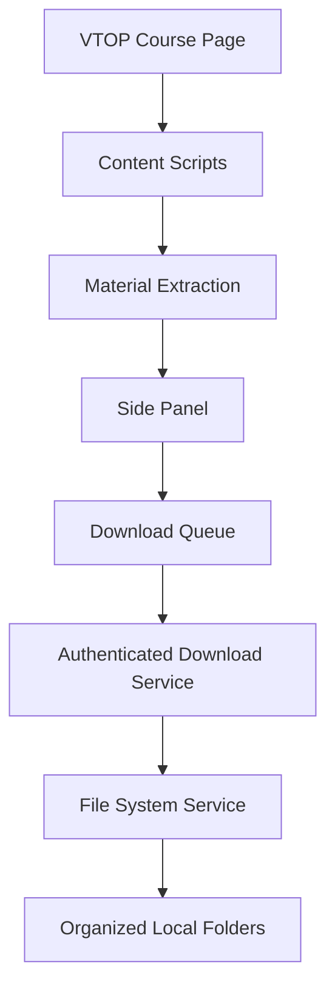

# VTOP Material Organizer

A Chrome extension that downloads and organizes course materials from VIT's VTOP portal into structured local folders.

## Overview

Downloading course materials manually from VTOP can be tedious, especially when materials are spread across multiple pages.

VTOP Material Organizer automates the process. It detects the active course, extracts its materials, downloads selected files, and organizes them into folders on your computer.

## Features

- **Automatic course detection** — identifies course details, faculty, and course type.
- **Complete material extraction** — handles paginated tables to retrieve all available materials.
- **Authenticated downloads** — uses your existing VTOP browser session.
- **Selective downloads** — download individual materials, selected files, or everything.
- **Queue controls** — sequential downloads with progress tracking, pause, resume, cancel, and retry.
- **Automatic organization** — sorts files by course, faculty, and embedded course type.
- **Filename handling** — cleans VTOP filenames and prevents accidental overwrites.
- **Persistent folder selection** — remembers your chosen download directory.

## Architecture

The extension uses Chrome Manifest V3 and separates page extraction, download management, and file storage.



**Main components**

| Component | Responsibility |
|---|---|
| `content/` | Detects VTOP pages and extracts course materials |
| `sidepanel/` | User interface and download controls |
| `services/` | Downloading, queue management, state, errors, and file writing |
| `utils/` | Filename processing, folder organization, and material selection |
| `background/` | Extension service worker |

## Technology Stack

- JavaScript (ES Modules)
- Chrome Extension Manifest V3
- Chrome Side Panel and Scripting APIs
- Fetch API and AbortController
- File System Access API
- IndexedDB
- Node.js built-in test runner

No build step or external runtime dependencies are required.

## Installation

**Requirements:** Google Chrome or a compatible Chromium-based browser, Node.js for running tests, and an active VTOP account.

1. Clone the repository:

   ```bash
   git clone https://github.com/DERIC-24/VTOP-Organizer.git
   ```

2. Open `chrome://extensions` in Chrome.
3. Enable **Developer mode**.
4. Click **Load unpacked**.
5. Select the cloned `VTOP-Organizer` directory.

## Usage

1. Log in to [VTOP](https://vtop.vit.ac.in).
2. Navigate to **Course Page Consolidated**.
3. Open the VTOP Material Organizer Side Panel.
4. Click **Refresh & Scan Course**.
5. Choose a destination folder.
6. Select individual materials or use **Select All**.
7. Choose a folder organization mode.
8. Click **Download Selected** or **Download All**.
9. Monitor progress and use the queue controls when needed.

## Folder Organization

Two organization modes are available.

**Course → Faculty → Materials**

```text
Downloads/
└── BECE302 - Digital Signal Processing/
    ├── ETH - Embedded Theory/
    │   └── Faculty One/
    │       ├── Lecture_01.pdf
    │       └── Lecture_02.pdf
    └── ELA - Embedded Lab/
        └── Faculty One/
            └── Lab_Sheet_01.pdf
```

**Course → All Materials**

```text
Downloads/
└── BECE302 - Digital Signal Processing/
    ├── ETH - Embedded Theory/
    │   ├── Lecture_01.pdf
    │   └── Lecture_02.pdf
    └── ELA - Embedded Lab/
        └── Lab_Sheet_01.pdf
```

Course-type folders are created when multiple embedded types are detected. Supported labels include ETH, ELA, EPJ, TH, LO, and SS.

## Permissions and Privacy

The extension requests:

| Permission | Purpose |
|---|---|
| `sidePanel` | Displays the extension interface |
| `storage` | Saves organization preferences |
| `scripting` | Extracts material information from VTOP |

It also requires host access to `https://vtop.vit.ac.in/*` for page interaction and authenticated downloads.

- VTOP authentication uses the existing browser session.
- CSRF and authorization form values are used in memory for download requests.
- The selected directory handle is stored locally in IndexedDB.
- Downloaded files are saved to the directory selected by the user.
- The extension does not require a separate account or external backend.

## Testing

Run the automated test suite:

```bash
node --test tests/run-tests.mjs
```

The tests cover material extraction, pagination, filename processing, folder organization, download validation, queue behavior, retries, progress tracking, pause/resume, cancellation, and selective downloads.

## Troubleshooting

| Issue | What to do |
|---|---|
| Materials not detected | Ensure you're on the VTOP Course Page Consolidated page and click Refresh & Scan Course |
| Authentication failure | Refresh VTOP, log in again if prompted, then scan the course again |
| Directory permission error | Use Re-authorize or choose the destination folder again |
| Material cannot be downloaded | Check whether the material has a valid downloadable file ID |
| Download failure | Check your VTOP session and retry failed materials |

**Limitations**

- Downloads operate on one course at a time.
- Paused transfers restart from the beginning when resumed.
- The Side Panel must remain open while downloads are running.
- The extension requires a compatible Chromium browser.

## Project Structure

```text
VTOP-Organizer/
├── background/
├── content/
├── services/
├── sidepanel/
├── utils/
├── tests/
├── manifest.json
└── README.md
```

## Future Improvements

Potential additions include multi-course downloads, persistent download history, completion notifications, and byte-range download resumption.

---

**Repository:** [DERIC-24/VTOP-Organizer](https://github.com/DERIC-24/VTOP-Organizer)